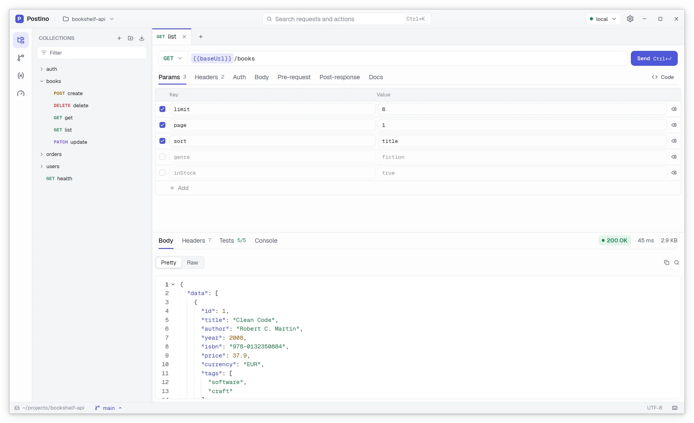
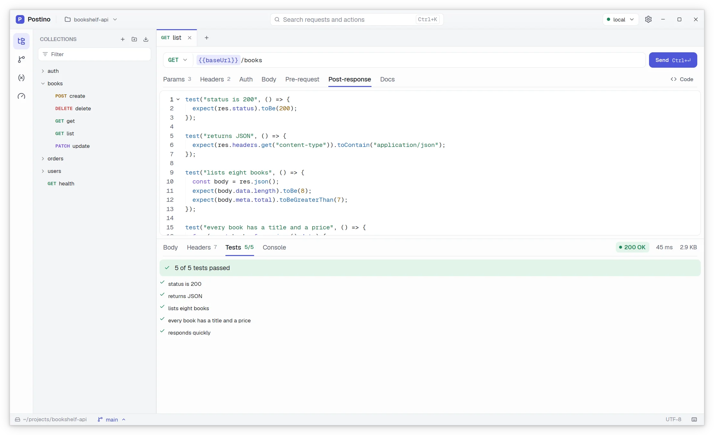
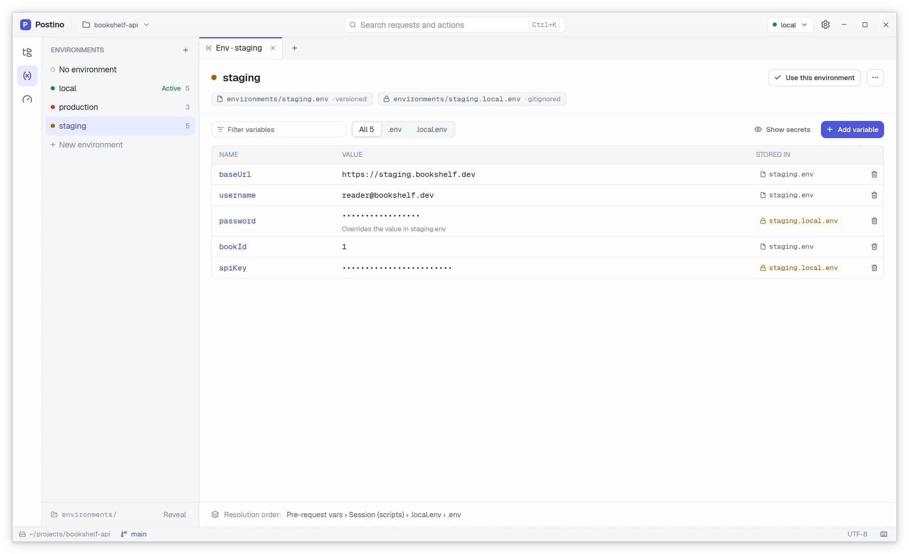
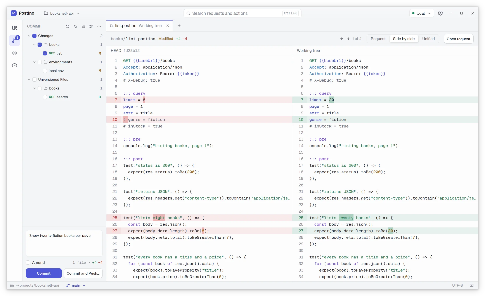
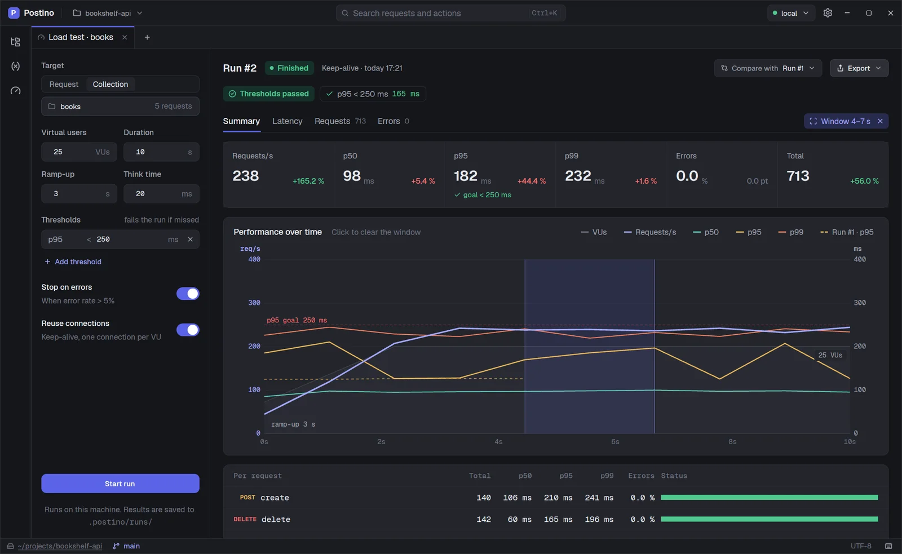
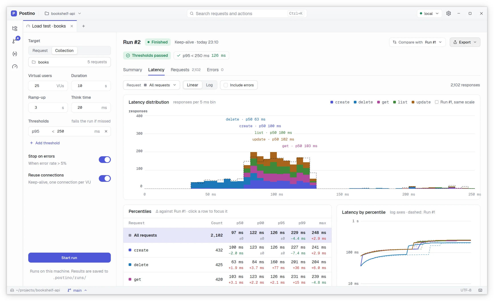
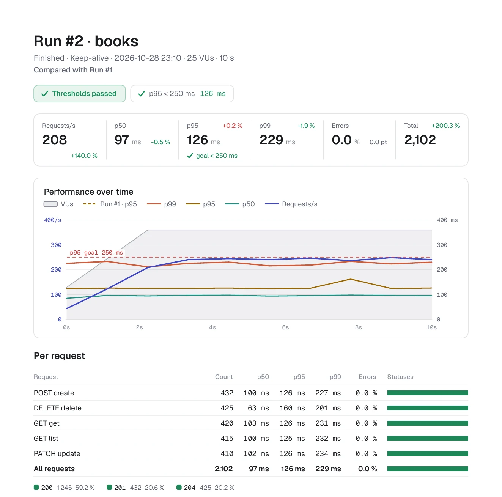

# Postino

[](https://github.com/tanisperez/postino/releases/latest)
[](https://github.com/tanisperez/postino/actions/workflows/build.yml)
[](LICENSE)
[](https://postino.tanis.codes/install.html)

A lightweight, native, open source HTTP client, without accounts, telemetry or cloud storage.
Your requests live as plain files on your disk, and you decide where they go: git, a shared
folder, or nowhere else. Coming from Postman? Postino imports your collections and environments.

[Website](https://postino.tanis.codes) · [Download](https://postino.tanis.codes/install.html) ·
[Documentation](#documentation)

<picture>
  <source media="(prefers-color-scheme: dark)" srcset="site/img/hero-dark.webp">
  
</picture>

> Status: verified on Linux and macOS. The Windows build has not been verified yet.

Scripts and tests in JavaScript, before and after each request:

<picture>
  <source media="(prefers-color-scheme: dark)" srcset="site/img/scripts-dark.webp">
  
</picture>

Environments with their variables, secrets kept apart in a gitignored `.local.env` file:

<picture>
  <source media="(prefers-color-scheme: dark)" srcset="site/img/environments-dark.webp">
  
</picture>

Git built in: review what changed in each request, stage it, commit, push and pull without
leaving the window:

<picture>
  <source media="(prefers-color-scheme: dark)" srcset="site/img/git-dark.webp">
  
</picture>

## Load testing

Point a load test at a request or a whole folder, with the same environments and scripts. Watch
requests per second and latency live, set p95 or error rate goals the run must meet, compare it
with an earlier run, and dig into every request it made. Then export it as a PDF report, Markdown,
CSV or JSON. [Watch the video](https://postino.tanis.codes/#load-testing):

<a href="https://postino.tanis.codes/#load-testing">
  
</a>

The latency of every request, compared with the previous run on the same scale:

<picture>
  <source media="(prefers-color-scheme: dark)" srcset="site/img/loadtest-latency-dark.webp">
  
</picture>

A PDF report ready to attach to a ticket or a pull request:



## Install

Download the Windows installer or portable zip, the macOS disk image (Apple silicon) or the Linux
packages from the [download page](https://postino.tanis.codes/install.html) or the
[latest release](https://github.com/tanisperez/postino/releases/latest). On Linux, install from
the signed repositories to get updates with the rest of your system:

```
# Debian and Ubuntu
sudo curl -fsSLo /etc/apt/keyrings/postino.asc https://postino.tanis.codes/postino.asc
echo "deb [signed-by=/etc/apt/keyrings/postino.asc] https://postino.tanis.codes/apt stable main" \
    | sudo tee /etc/apt/sources.list.d/postino.list
sudo apt update && sudo apt install postino

# Fedora
sudo curl -fsSLo /etc/yum.repos.d/postino.repo https://postino.tanis.codes/rpm/postino.repo
sudo dnf install postino

# Any distribution, for your user under ~/.local (run again to update)
curl -fsSL https://postino.tanis.codes/install.sh | bash
```

The builds are not code signed yet. See
[first launch](https://postino.tanis.codes/install.html#first-launch) if macOS or Windows asks before opening
Postino.

## Building from source

Install Rust with [`rustup`](https://rustup.rs). The toolchain version is pinned in
`rust-toolchain.toml` and installed on the first build. Then install the system dependencies for
your platform:

- **Linux** (Debian and Ubuntu package names):

  ```
  sudo apt install build-essential pkg-config cmake libfontconfig-dev libfreetype-dev \
      libwayland-dev wayland-protocols libxkbcommon-dev libxkbcommon-x11-dev \
      libx11-xcb-dev libxcb1-dev libvulkan-dev
  ```

- **macOS**: Xcode, with its command line tools.
- **Windows**: the Visual Studio Build Tools with the "Desktop development with C++" workload.

Build and run:

```
git clone https://github.com/tanisperez/postino.git
cd postino
cargo run                    # debug build
cargo build --release        # optimized binary in target/release/postino
cargo test --all-targets     # run the tests
```

On Linux and macOS the `Makefile` wraps the usual commands (`make run`, `make release`,
`make test`, `make lint`, ...). On Linux, `make install` builds and installs Postino for your
user under `~/.local`, with its menu entry and icons, `make install-latest` installs the latest
release instead, and `make uninstall` removes either. `make sample` starts a local test server and
opens a workspace of about 140 requests that exercise every feature. Run `make help` for the full
list.

## Documentation

The user guide is at <https://postino.tanis.codes/docs/>. Good places to start:

- [Quick start](https://postino.tanis.codes/docs/quick-start.html): a first workspace, request
  and environment.
- [Importing from Postman](https://postino.tanis.codes/docs/postman-import.html): collections and
  environments exported from Postman.
- [Scripts and tests](https://postino.tanis.codes/docs/scripting.html): pre-request and
  post-response scripts, with the full [Script API](https://postino.tanis.codes/docs/script-api.html).
- [File format](https://postino.tanis.codes/docs/file-format.html): how requests, collections and
  environments are stored.
- [Working with git](https://postino.tanis.codes/docs/git.html): keeping requests in git next to your
  code.

To report a bug or work on the code, see
[Contributing](https://postino.tanis.codes/docs/contributing.html). The developer documents live
in [`docs/`](docs): the [architecture](docs/architecture.md), the format and scripting
implementation references ([`format.md`](docs/format.md), [`scripting.md`](docs/scripting.md))
and [releasing](docs/releasing.md).

## Built with

- [Rust](https://www.rust-lang.org) and [gpui-kit](https://crates.io/crates/gpui-kit), the
  components for the [GPUI](https://www.gpui.rs) UI framework.
- [telaio](https://github.com/tanisperez/telaio), the design system and standard components
  Postino shares with its sibling apps: palette, theme, fonts, buttons, modals and the rest.

## License

Copyright 2026 Estanislao Pérez Nartallo.

Postino is licensed under the [Apache License 2.0](LICENSE). See [NOTICE](NOTICE).
